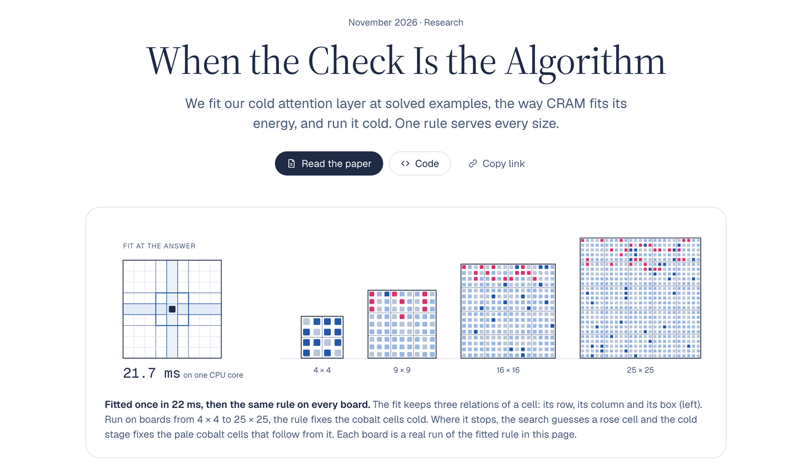

# When the Check Is the Algorithm

<p align="center">
  <a href="https://neovand.github.io/cold-check">
    
  </a>
</p>

<p align="center">
  <a href="paper/main.pdf">Paper (PDF)</a> ·
  <a href="https://neovand.github.io/cold-check">Page with live demos</a> ·
  <a href="code/">Code</a>
</p>

Paper, code and page for *When the Check Is the Algorithm*. The page runs the fitted rules in your browser, on Sudoku
from 4×4 to 25×25, on mazes, and on breadth-first search, at
[neovand.github.io/cold-check](https://neovand.github.io/cold-check).

We fit the *check* of our cold attention layer ([Attention at Absolute Zero](https://github.com/NeoVand/cold-attention))
at solved examples, the way CRAM fits its energy ([Hoover, Blayney and Whittington](https://github.com/Prefrontal-AI/CRAM)):
each part of a solved answer is predicted from the rest, with no loop, in milliseconds. Before fitting, we complete each
answer from itself with closures and counts, such as each node's place in the order a breadth-first search discovered
it. We keep every condition that held on all training answers, including the one a finished answer cannot show: that
every fact rests on earlier facts. Then we run the check cold, from nothing, and search only where it forces nothing.
The check's weights attach to relations, not positions, so one fitted rule serves every size.

## Results

| Benchmark | Result |
|---|---|
| **Sudoku-Extreme** (412,786 test puzzles) | **all 412,786 solved** on each of three fits, no wrong answer; fit in 15–22 ms on one CPU core; 5.6×10⁴ operations per puzzle (CRAM: 99.996%, 2.0×10⁹); 13.9% solved by the cold stage alone |
| **One 9×9 rule, every board size** | 4×4: 1,000/1,000 · 16×16: 1,000/1,000 · **25×25: 100/100** (CRAM needs one model per size) |
| **Maze-Hard** (1,000) | **1,000/1,000** with no hand-built distance layer, including the maze CRAM misses on every seed; 136/136 room mazes; 300/300 looped mazes up to 121×121 |
| **Maze-Unique** (1,000) | **1,000/1,000** by the cold stage alone; 600/600 mazes with dead ends at the board's edge (CRAM's released model: 0/600) |
| **N-Queens**, fitted on 8×8 | 600/600 boards at 80×80 and 100×100, from 9 queens missing to an empty board |
| **3-colouring**, fitted on 10 vertices | 300/300 graphs of 100 vertices |
| **CLRS-30** | **all 30 algorithms exact**: 159 of 159 test sets at 100% (official test, validation, held-out inputs up to 1,024 nodes, 4,096 items and 5,120 characters); fitted at the answer on one core, 18 ms to 4.1 s for the 15 that use comparisons and counts only; the other 15 get one supplied piece, named in the paper's table |

Every number above is read from `code/bench/final/summary.json` and `code/clrs/final/summary.json` (frozen code, one
budget, one run).

## Layout

```
paper/     the paper (main.pdf) and its source
code/      every experiment, its result files, and one command per result (code/README.md)
site/      the page (SvelteKit); its build copies paper/main.pdf in, and the GitHub Action deploys it to Pages
```

CRAM's code and the puzzle datasets are not redistributed here: `code/fetch.py` fetches them at pinned revisions
(CRAM at commit 62bbe83, Apache 2.0; Sudoku-Extreme, Maze-Hard and Maze-Unique from Hugging Face). The CLRS-30 splits
we used are in `code/clrs/clrs30/`, made with DeepMind's `dm-clrs` 2.0.3.

## Page

```bash
cd site && pnpm install && pnpm dev       # http://localhost:5173
pnpm test                                 # the page's engines against the Python runs, move for move
```

## Citation

```bibtex
@misc{mohsenvand2026check,
  title  = {When the Check Is the Algorithm},
  author = {Mohsenvand, Mostafa},
  year   = {2026},
  url    = {https://github.com/NeoVand/cold-check}
}
```

## License

Apache 2.0.
